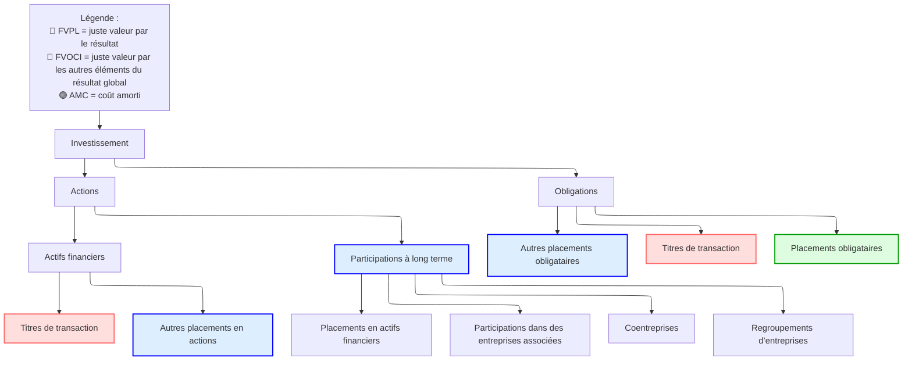

# Investissements intersociétés

## Catégories de base des investissements d’entreprise

### Catégories

Le schéma suivant décrit les catégories d’investissement du point de vue comptable.

#### Participations à long terme

Comme indiqué ci-dessus, les participations à long terme se répartissent en 4 catégories selon le degré de contrôle :

* **Placements en actifs financiers** : ni contrôle ni influence notable
* **Participations dans des entreprises associées** : influence notable
* **Coentreprise** : contrôle partagé
* **Regroupement d’entreprises** : prise de contrôle

Le **pourcentage de détention** sert généralement à déterminer la catégorie appropriée :

* $(0,20)$ absence d’influence
* $(20,50)$ influence notable
* $(50,100)$ contrôle

|                            | Actifs financiers         | Entreprises associées            | Coentreprises | Regroupement d’entreprises |
| -------------------------- | ------------------------ | --------------------- | -------------- | -------------------- |
| **Degré d’influence**    | pas d’influence notable | influence notable | contrôle partagé | contrôle              |
| **Pourcentage de détention** | < 20 %                    | 20 % - 50 %             | variable         | > 50 %                |
| **Nom de l’entité détenue**       | -                        | entreprise associée             | -              | filiale           |
| **Traitement comptable**   | AMC, FVOCI, FVPL         | Mise en équivalence         | Mise en équivalence  | Méthode de l’acquisition   |

> [!Note]
>
> Revoir ce tableau avec les contenus suivants pour le détail des méthodes.

> [!Important]
>
> En cas d’acquisition, vérifier si les sociétés ont un actionnaire de contrôle commun, c’est-à-dire deux entités ou plus contrôlées par un même contrôlant.

## Placements en actifs financiers

### Classement des actifs financiers

# Notes de révision

##  Classement

Instruments de dette

* Détenus pour encaisser les flux contractuels $\to$ AMC (coût amorti) : valeur fixe (flux actualisés au taux d’émission)
* Détenus pour encaisser et vendre $\to$ FVOCI : en autres éléments du résultat global (juste valeur)
* Transaction $\to$ FVPL : au compte de résultat (juste valeur)

Instruments de capitaux propres

* Détenus pour encaisser et vendre $\to$ FVOCI : en autres éléments du résultat global
* Transaction $\to$ FVPL : au compte de résultat

>[!note]
>
>* Le revenu de détention (produit d’intérêts) est fixe : coût amorti $\times$ taux d’émission, enregistré au **compte de résultat**
>
>* Les gains et pertes diffèrent : ignorés en AMC, en OCI en FVOCI, au compte de résultat en FVPL

## Reclassement

* Les IFRS n’autorisent pas le reclassement des instruments de capitaux propres
* Le reclassement d’un instrument de dette est autorisé lorsque le modèle économique change

## Informations à fournir

La juste valeur doit être publiée dans tous les cas

## Traitement comptable

### Mise en équivalence

> [!note]
>
> Définition d’une entreprise associée/coentreprise : influence notable sans contrôle

#### Au bilan

* Valeur comptable de la participation enregistrée au coût
* +Résultat net ajusté (résultat publié - amortissement de juste valeur - profit latent)
* -Dividendes
* =Valeur comptable de clôture de la participation

#### Au compte de résultat

* Résultat net de l’acquéreur
* +Résultat net ajusté de la société acquise
* =Résultat net consolidé

#### Goodwill implicite

Goodwill implicite = coût d’acquisition $- \ \%\times$ FVNIA (juste valeur de l’actif net identifiable)

#### Amortissement de juste valeur

FVA = $\frac{\text{FV(PPE)}-\text{BV(PPE)}}{N}$ (amortissement linéaire)

#### Profit latent (profit différé)

Opération descendante : acquéreur $\to$ société acquise

Opération ascendante : société acquise $\to$ acquéreur

Ni les opérations descendantes ni les ascendantes ne doivent être traitées comme du résultat net. Elles doivent être déduites au compte de résultat.

#### Dépréciation

|                     | IFRS                                  | US GAAP                       |
| ------------------- | ------------------------------------- | ----------------------------- |
| **Test de dépréciation** | valeur comptable > *valeur recouvrable* | valeur comptable > *juste valeur* |
| **Perte de valeur** | comptabilisée au compte de résultat                     | comptabilisée au compte de résultat             |
| **Reprise**        | *autorisée*                              | *interdite*                    |

#### Questions d’analyse liées à la mise en équivalence

* Sous-estime le ratio d’endettement
* Surestime la marge nette (NI/REV=(NIA+NIB)/REVA)

### Méthode de l’acquisition

>[!note]
>
>Définition d’une filiale/VIE : l’investisseur contrôle l’activité de l’entité détenue
>
>Types : A+B = (A+B), A+B = A
>
>Une VIE ou SPE est une structure juridique par laquelle une société veut garder le contrôle d’une autre entité sans la détenir

#### Situations au bilan

* Acquisition partielle avec prime : goodwill complet > goodwill partiel, intérêts minoritaires complets > partiels
* Acquisition totale : goodwill complet = goodwill partiel, intérêts minoritaires complets = partiels = 0
* Achat à prix réduit : gain au compte de résultat

#### Consolidation du compte de résultat

**Compte de résultat de A après l’acquisition :**

| Poste       | Valeur |
| ---------- | ----- |
| Produits     | X     |
| Charges    | Y     |
| Résultat net | Z     |

**Compte de résultat de B après l’acquisition (après ajustement à la juste valeur) :**

| Poste       | Valeur |
| ---------- | ----- |
| Produits     | x     |
| Charges    | y     |
| Résultat net | z     |

**Compte de résultat consolidé de A après l’acquisition :**

| Poste                             | Formule     |
| -------------------------------- | ----------- |
| Produits                           | X + x       |
| Charges                          | Y + y       |
| Résultat net                       | Z + z       |
| Résultat net part du groupe | Z + % × z   |
| Intérêts minoritaires                | (1 - %) × z |

**Étapes :**
1. **Ajustement à la juste valeur** du compte de résultat de B (amortissement de juste valeur et profit différé)
2. **Consolidation à 100 %**
3. **Calcul du résultat net part du groupe**

#### Dépréciation du goodwill

|                     | IFRS                                             | US GAAP                                |
| ------------------- | ------------------------------------------------ | -------------------------------------- |
| **Objet**          | Unités                                            | Goodwill                               |
| **Test de dépréciation** | Valeur comptable (unité) > *valeur recouvrable (unité)*  | Valeur comptable (GW) > *juste valeur (GW)* |
| **Dépréciation**      | 1. Le goodwill est ramené à 0                      | Le goodwill est ramené à 0,              |
|                     | 2. Les autres actifs sont dépréciés au prorata | Pas de dépréciation supplémentaire des autres actifs   |
| **Reprise**         | Interdite                                      | Interdite                            |

#### Comparaison avec la mise en équivalence (détention < 100 %)

| États financiers et ratios | Mise en équivalence      | Méthode de l’acquisition           |
| -------------------------- | ------------------ | ---------------------------- |
| Actifs et passifs         | Plus faibles : A / L       | Plus élevés : (A + a) / (L + l) ↑  |
| Capitaux propres                     | Plus faibles : E           | Plus élevés : E + M ↑              |
| Produits et charges         | Plus faibles : X / Y       | Plus élevés : X + x / Y + y ↑      |
| Résultat net (NI)            | Identique : Z        | Identique : Z + 3 % (hypothèse) = |
| Marge nette          | Plus élevée : NI / X     | Plus faible : NI / (X + x) ↓        |
| ROE et ROA                | Plus élevés : NI / A moyen | Plus faibles : NI / (A + a) moyen ↓    |
