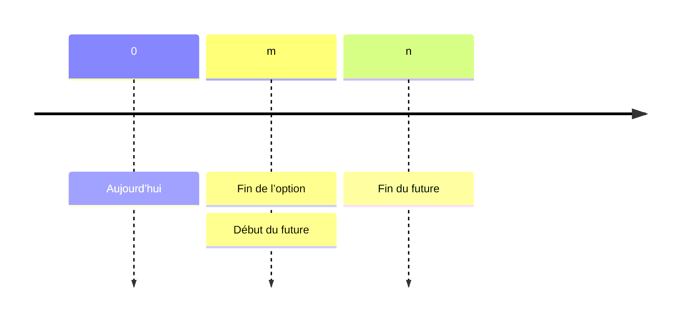
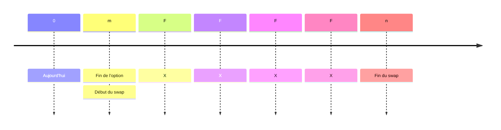

<style>
.blur-hover {
    filter: blur(5px);
    transition: filter 0.3s;
}
.blur-hover:hover {
    filter: none;
}
</style>

# Options

La logique fondamentale est l’**absence d’arbitrage**.

## Valorisation binomiale des options {#binomial-option-valuation}

### Formule de base {#basic-formula}

En univers risque-neutre, la formule binomiale à chaque étape est :
$$
\begin{align}

   S_u &= S_0 \cdot u\\
   S_d &= S_0 \cdot d\\
   p_u &= \frac{e^{r\Delta t}}{u-d}\\
   p_d &= 1-p_u\\
   C_T &= \max(S_T-X,0)\\
   C_0 &= e^{-r\Delta t} (pC_u + (1-p)C_d)

\end{align}
$$

```python
class BinomialTreeOption:
    def __init__(self, df_spy, X, T, r, N, option_type="call"):
        """
        Initialize the Binomial Tree for option pricing with stage-specific volatility.
        """
        self.df_spy = df_spy
        self.S = spy_price
        self.X = X
        self.T = T
        self.r = r
        self.N = N
        self.option_type = option_type
        self.dt = T / N  # Time step size

    def compute_rolling_volatility(self, current_date, window=30):
        """
        Compute rolling volatility up to a given trading date.
        """
        spy_subset = self.df_spy.loc[:current_date]  
        log_returns = np.log(spy_subset["Close"] / spy_subset["Close"].shift(1))
        rolling_vol = log_returns.rolling(window=window).std() * np.sqrt(252)

        return rolling_vol.iloc[-1]  
    def build_stock_tree(self):
        """
        Build the binomial tree for stock prices with dynamic volatility.
        """
        stock_tree = np.zeros((self.N + 1, self.N + 1))
        stock_tree[0, 0] = self.S  

        trading_dates = self.df_spy.index[-self.N:]  

        for i in range(1, self.N + 1):
            current_date = trading_dates[i - 1]  
            sigma_t = self.compute_rolling_volatility(current_date)  
            u = np.exp(sigma_t * np.sqrt(self.dt))  
            d = np.exp(-sigma_t * np.sqrt(self.dt))  

            for j in range(i + 1):
                stock_tree[j, i] = stock_tree[0, 0] * (u ** (i - j)) * (d ** j)

        return stock_tree

    def build_option_tree(self):
        """
        Build the option price tree using backward induction.
        """
        stock_tree = self.build_stock_tree()
        option_tree = np.zeros((self.N + 1, self.N + 1))

        if self.option_type == "call":
            option_tree[:, self.N] = np.maximum(stock_tree[:, self.N] - self.X, 0)
        elif self.option_type == "put":
            option_tree[:, self.N] = np.maximum(self.X - stock_tree[:, self.N], 0)

        trading_dates = self.df_spy.index[-self.N:] 

        for i in range(self.N - 1, -1, -1):
            current_date = trading_dates[i]  
            sigma_t = self.compute_rolling_volatility(current_date) 
            u = np.exp(sigma_t * np.sqrt(self.dt))
            d = np.exp(-sigma_t * np.sqrt(self.dt))
            p = (np.exp(self.r * self.dt) - d) / (u - d)  

            for j in range(i + 1):
                option_tree[j, i] = np.exp(-self.r * self.dt) * (
                    p * option_tree[j, i + 1] + (1 - p) * option_tree[j + 1, i + 1]
                )

        return option_tree

    def price(self):
        """
        Compute the option price at time 0.
        """
        option_tree = self.build_option_tree()
        return option_tree[0, 0]

def compute_binomial_price(row, df_spy, r, N):
    X = row["strike"]
    expiration = row["expiration"]
    # set to global T
    T_local = T
    option = BinomialTreeOption(df_spy, X, T_local, r, N)
    return option.price()
```

### Composantes {#components}

Hypothèses de base de l’arbre binomial :

* On part de $S_0$
* Hausse $U$, baisse $D$, avec par défaut $D=\frac{1}{U}$.

#### Modèle 1 {#model-one}

Proposé par Bruce Tuckman pour décrire la valorisation obligataire :
$$
dr = \sigma dw
$$


où $r$ est le taux d’intérêt et $w$ un processus de marche aléatoire. Pour un temps égal à $1$, $r_u =r+\sigma$, $r_d = r-\sigma$. Ainsi $S_u = Se^{\sigma}=SU$, $S_d=Se{-\sigma}=SD$, donc $D=\frac{1}{U}$ par défaut.

### Probabilité risque-neutre {#risk-neutrual-probability}

Par absence d’arbitrage, le cours attendu de l’action est :
$$
E(S_t) = \pi_uS_0U+(1-\pi_u)S_9D
$$
qui doit être égal au rendement sans risque $S_0(1+r_f)^t$, d’où :
$$
\begin{align}
\pi_u &= \frac{(1+r_f)^T-D}{U-D}\\
\pi_d &= 1-\pi_u = \frac{U-(1+r_f)^T}{U-D}
\end{align}
$$

### Modèle binomial à une période {#one-period-binomial-model}

On suppose une option européenne :
$$
\begin{align}
C_{u,t}&= \max(0, S_u-X)\\
P_{u,t}&=\max(0, X-S-u)\\
C_{d,t}&=\max(0,S_d-X)\\
P_{d,t}&=\max(0,X-S_d)
\end{align}
$$
Alors $C_0=PV(E(C))=\frac{(\pi_u C_{u,t}+\pi_d C_{d,t})}{(1+r_f)^t}$ et $P_o = \frac{(\pi_u P_{u,t}+\pi_d P_{d,t})}{(1+r_f)^t}$.

### Parité call-put {#put-call-parity}

|              | **Call fiduciaire**      | **Put de protection** |
| ------------ | ----------------------- | ------------------ |
|              | $c + \frac{X}{1+r_f}^t$ | $S+p$              |
| **Si S ≤ X** | $0+X=X$                 | $S+(X-S)=X$        |
| **Si S ≥ X** | $(S-X)+X=S$             | $S+0=S$            |

On obtient :
$$
c+\frac{X}{(1+r_f)^t}=S_0+p
$$

### Méthode du portefeuille sans risque {#risk-free-portfolio-method}

1. On construit un portefeuille sans risque en achetant $\delta$ actions et en vendant un call ; sa valeur en $0$ est :
   $$
   V_{0}=c-\delta S_0
   $$

2. En $t$ :
   $$
   \begin{align}
   V_{u,t}&=\delta S_u-C_u\\
   V_{d,t}&=\delta S_d-C_d
   \end{align}
   $$

3. Comme le portefeuille est sans risque, $V_{u,t}=V_{d,t}$, d’où :
   $$
   \delta S_0 = \frac{C_u-C_d}{U-D}
   $$

4. On obtient ensuite $C_0$ par $V_{u,t}=V_{d,t}=(1+r_f)^t V_0$, avec $V_0 = c-\delta S_0$ :
   $$
   C_0 = \delta S_0+\delta S_u -C_u
   $$
   On retrouve la même formule que par la méthode de la probabilité risque-neutre.


> [!Note]
>
> Un arbitrage existe lorsque les valeurs diffèrent ; $\delta$ est le ratio d’arbitrage.


### Modèle binomial à deux périodes {#two-period-binomial-model}

Comme dans le modèle à une période, $\pi_u$ et $\pi_d$ se calculent de la même façon (ce sont d’ailleurs les mêmes valeurs !). Il suffit ensuite de calculer la valeur actuelle de l’espérance.

#### Exemple {#example}

Soit une action ne versant pas de dividende, cotée €50. Un call européen sur cette action a une échéance de deux ans et un prix d’exercice de €50. Le taux sans risque est de 5 % par an. Le facteur de hausse (U) vaut 1,356 et le facteur de baisse (D) 0,744. Calculer la valeur actuelle du call et celle du put correspondant.

<span class="blur-hover">

On procède ainsi :

**Étape 1** : calculer les cours de l’action dans l’arbre. Le cours hausse-hausse vaut $S^{++} = 91.94$, les cours hausse-baisse et baisse-hausse $S^{+-} = S^{-+} = 50.44$, et le cours baisse-baisse $S^{–} = 27.68$.

**Étape 2** : calculer les valeurs des options à l’échéance. Pour le call, $C^{++} = 41.95$ et $C^{+-} = C^{-+} = 0.44$ ; la valeur baisse-baisse est $C^{–} = 0$. Pour le put, $P^{++} = P^{+-} = P^{-+} = 0$ et $P^{–} = 22.32$.

**Étape 3** : calculer la probabilité risque-neutre. La probabilité de hausse est $\pi_U = \frac{(1 + 0.05) - 0.744}{1.356 - 0.744} = 0.5$ et celle de baisse $\pi_D = 1 - \pi_U = 0.5$.

On calcule ensuite les valeurs intermédiaires. Pour le call, $C^{+} = \frac{(0.5 \times 41.94 + 0.5 \times 0.44)}{1.05} = 20.18$ et $C^{-} = \frac{(0.5 \times 0.44 + 0.5 \times 0)}{1.05} = 0.22$. Pour le put, $P^{+} = \frac{(0.5 \times 0 + 0.5 \times 0)}{1.05} = 0$ et $P^{-} = \frac{(0.5 \times 0 + 0.5 \times 22.32)}{1.05} = 10.63$.

**Étape 4** : calculer les valeurs initiales. Le call vaut $C_0 = \frac{(0.5 \times 20.18 + 0.5 \times 0.22)}{1.05} = 9.71$ et le put $P_0 = \frac{(0.5 \times 0 + 0.5 \times 10.63)}{1.05} = 5.06$.

En complément, la parité call-put permet de vérifier :

$P_0 = C_0 + PV(X) - S_0 = 9.71 + \frac{50}{(1.05)^2} - 50 = 5.06$.

</span>

### Exercice anticipé des options américaines {#advance-exercise-of-american-option}

* Un call américain sur une action sans dividende n’est pas exercé de manière anticipée, car la valeur de l’option dépasse la valeur d’exercice : *elle vaut plus vivante que morte*.
* Un call américain sur une action à dividende, ou très dans la monnaie, peut être exercé plus tôt.

### Modèle binomial à deux périodes pour une option américaine {#two-period-binomial-model-of-american-option}

Une option américaine peut être exercée de manière anticipée lorsque :

* La valeur d’exercice dépasse la valeur de non-arbitrage
* À chaque nœud, on retient la plus élevée entre la valeur d’exercice et le prix calculé.

> [!Note]
>
> Calculer la valeur de l’option en cas d’exercice

### Options de taux {#interest-rate-option}

La valorisation suit le modèle binomial standard, mais on multiplie par le nominal.


## Modèle de Black-Scholes {#black-scholes-model}

### Hypothèses {#assumption}

Le modèle de Black-Scholes est la version continue du modèle binomial (lorsque $t\to\infty$).

* Le sous-jacent suit un mouvement brownien géométrique et son prix évolue de façon continue.

* Le taux sans risque en capitalisation continue est constant et connu ; on peut emprunter et prêter à ce taux.
* La volatilité du sous-jacent est constante
* Le marché est sans frictions :
  * Pas de coûts de transaction, d’impôts ni de contraintes réglementaires
  * Pas d’arbitrage
  * Le sous-jacent est très liquide et se négocie en continu
  * La vente à découvert du sous-jacent est autorisée

### Formule de base {#basic-formula-1}

La formule de Black-Scholes est :
$$
\begin{align}

​    C_0 &= S_0 N(d_1) - X e^{-r_f^cT} N(d_2) \\
P_0&= C_0+Xe^{-r_f^cT}-S_0\\
&=-S_0N(-d_1)+Xe^{-r_f^cT}N(-d_2)
\\

​    d_1 &= \frac{\ln(\frac{S_0}{X}) + (r_f^c + \frac{1}{2} \sigma^2)T}{\sigma\sqrt{T}} \\

​    d_2 &= d_1 - \sigma\sqrt{T}

\end{align}
$$

```python
def black_scholes(S, X, T, r, sigma):
    d1 = (np.log(S / X) + (r + 0.5 * sigma ** 2))/(sigma * np.sqrt(T))
    d2= d1 - sigma * np.sqrt(T)
    return S * norm.cdf(d1) - X * np.exp(-r * T) * norm.cdf(d2)
```

### Lecture du modèle {#initial-model}

Comme pour la parité call-put, un **call** peut se voir comme un investissement en actions avec effet de levier (achat d’actions $N(d_1)$ et vente à découvert d’une obligation zéro-coupon sans risque $N_(d_2)$). Un **put** peut se voir comme l’achat de l’actif sans risque $N(-d_2)$ et la vente à découvert de l’action $N(-d_1)$.

#### Ce qu’il faut retenir sur $N(d_1)$ et $N(d_2)$ {#conclusion-of-n-d-1-and-n-d-2}

* $N(d_1)$ est le $\delta$ du call
* $-N(-d_1)$ est le $\delta$ du put
* $N(d_2)$ est la probabilité risque-neutre que le call soit exercé à l’échéance (dans la monnaie).
* $N(-d_2)$ est la probabilité risque-neutre que le put soit exercé à l’échéance (dans la monnaie).
* $N_(-d_2)=1-N(d_2)$.

### Modèle BSM avec revenus ou coûts de portage {#bsm-model-with-carrying-benefits-or-costs}

$$
\begin{align}
C_o &= S_0e^{-\gamma T}N(d_1)-Xe^{-r_f^cT}N(d_2) \\
P_o &= -S_0e^{-\gamma T}N(-d_1)+Xe^{-r_f^c T}N(-d_2) \\
d_1 &=\frac{\ln(\frac{S_0}{X})+(r_f^c-\gamma+\frac{\sigma^2}{2})}{\sigma\sqrt{T}}\\
d_2 &= d_1-\sigma\sqrt{T}
\end{align}
$$

### Options sur futures {#options-on-future}



#### Position {#position}

La position sur le future dépend de la position sur l’option :

* Achat de call $\to$ position acheteuse sur le future
* Achat de put $\to$ position vendeuse sur le future

Le prix d’exercice est fixé dans l’option. Pour un achat de call, on exerce si $F<F_m(n)$ ; pour un achat de put, si $F> F_m(n)$.

#### Modèle de Black {#black-model}

$$
\begin{align}
C_0 &= F_0(T)e^{-r_f^cT}N(d_1)-Xe^{-r_f^cT}N(d_2)\\
P_0 &= -F_0(T)e^{-r_f^cT}N(-d_1)+Xe^{-r_f^cT}N(-d_2)\\
d_1 &= \frac{\ln (\frac{F_0(T)}{X})+\frac{\sigma^2}{2}T}{\sigma\sqrt{T}}\\
d_2&=d_1-\sigma\sqrt{T}
\end{align}
$$

> [!Important]
>
> En pratique, l’option et le future ont souvent la même échéance (option américaine).

### Options de taux d’intérêt {#interest-rate-option-1}

Le contrat ressemble aux options sur futures et aux FRA. Le choix de position et les cas d’exercice sont exactement les mêmes que pour les options sur futures.
$$
\begin{align}
C_0 &= NPe^{-r_f^c n \frac{30}{360}}(FR_{m\times n} N(d_1)-XN(d_2))\frac{(n-m)30}{360}\\
P_0 &= NP e^{-r_f^cn\frac{30}{360}}(XN(-d_2)-FR_{m\times n}N(-d_1))\frac{(n-m)30}{360}
\end{align}
$$
### Swaption {#swapation}

Une swaption est une option d’entrer dans un swap :

1. Une swaption payeuse est l’option d’entrer dans un swap en tant que payeur du taux fixe (position acheteuse).
2. Une swaption receveuse est l’option d’entrer dans un swap en tant que receveur du taux fixe (position vendeuse).

$$
\begin{align}
C_0 &= NP(\text{Accural Period})\text{PVA of}(R_{fix}N(d_1)-R_XN(d_2))\\
P_0 &= NP(\text{Accural Period})\text{PVA of}(-R_{fix}N(-d_1)+R_XN(-d_2))
\end{align}
$$



## Les grecques {#greeks}

D’après le modèle de Black-Scholes,
$$
C_0 = S_0 N(d_1) - X e^{-r_f^cT} N(d_2) 
$$
que l’on peut lire comme :
$$
C_0 = f(S_0, X, r_f^c, T, \sigma)
$$
Le $\delta$ est alors défini par :
$$
\delta = \frac{\partial C_0}{\partial S_0}
$$
le $\gamma$ par :
$$
\gamma = \frac{\partial^2 C_0}{\partial S_0^2}=\frac{\partial \delta}{\partial S_0}
$$
le $\theta$ par :
$$
\theta = \frac{\partial C_0}{\partial t}
$$
le $\upsilon$ (vega) par :
$$
\upsilon = \frac{\partial C_0}{\partial \sigma}
$$
et le $\rho$ par :
$$
\rho = \frac{\partial C_0}{\partial r_f^ c}
$$

### Delta {#delta}

Pour une action sans dividende : $\delta_{call}=N(d_1)$, $\delta_{put} = -N(-d_1)$.

> [!Note]
>
> Dans ce cas, $\delta_{call}=\delta_{put}+1$


Pour une action à dividende : $\Delta_{call}=e^{-\delta T}N(d_1), \Delta_{put}=-e^{-\delta T}N(-d_1)$, où $\delta$ désigne ici le taux de dividende.

> [!Note]
>
> Le $\delta$ est compris entre $(0,1)$ pour un call et $(-1, 0)$ pour un put. Il varie plus fortement à l’approche de l’échéance.

### Gamma {#gamma}

> [!Note]
>
> $\gamma$ et $\delta$ jouent le rôle de la convexité et de la duration en obligataire.

Le $\gamma$ est maximal à la monnaie. Pour une option à la monnaie, il augmente à l’approche de l’échéance ; pour une option très dans ou très hors de la monnaie, il diminue à l’approche de l’échéance.

> [!Note]
>
> On peut construire une **stratégie $\gamma$-neutre** en combinant des positions d’options, puis une stratégie $\delta$-neutre en ajoutant une position sur l’action sous-jacente (puisque l’action n’a pas de $\gamma$).

### Thêta {#theta}

Le thêta est en général négatif pour les calls comme pour les puts, car leur valeur diminue avec le temps. Avec :

* **Exception :** les puts très dans la monnaie
