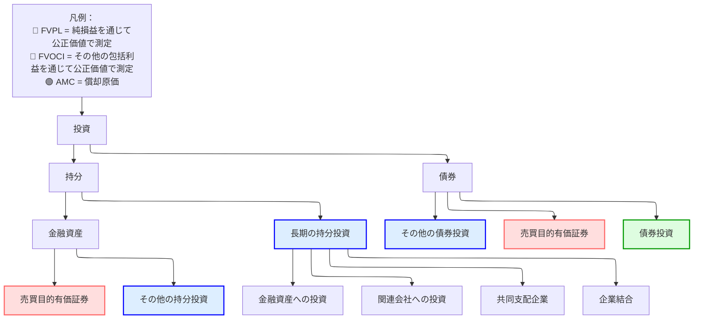

# 企業間投資

## 企業による投資の基本区分

### 区分

次の図は、会計上の投資の区分を示している。

#### 長期の持分投資

上のとおり、長期の持分投資は支配力の強さに応じて 4 つに分かれる：

* **金融資産への投資**：重要な支配力も影響力もない
* **関連会社への投資**：重要な影響力を及ぼす
* **共同支配企業**：支配を共有する
* **企業結合**：支配持分を取得する

適切な区分の判断には、通常**持分比率**を使う：

* $(0,20)$ 影響力なし
* $(20,50)$ 重要な影響力
* $(50,100)$ 支配

|                            | 金融資産         | 関連会社            | 共同支配企業 | 企業結合 |
| -------------------------- | ------------------------ | --------------------- | -------------- | -------------------- |
| **影響力の程度**    | 重要な影響力なし | 重要な影響力 | 共同支配 | 支配              |
| **持分比率** | < 20%                    | 20% - 50%             | さまざま         | > 50%                |
| **投資先の呼称**       | -                        | 関連会社             | -              | 子会社           |
| **会計処理**   | AMC、FVOCI、FVPL         | 持分法         | 持分法  | 取得法   |

> [!Note]
>
> 具体的な方法については、後の内容とあわせてこの表を見直すこと。

> [!Important]
>
> 買収の場合、両社に共通の支配者がいるか（2 つ以上の企業が 1 つの共通の支配者に支配されているか）に注意する。

## 金融資産への投資

### 金融資産の分類

# 復習ノート

##  分類

負債性金融商品

* 契約上のキャッシュフローの回収を目的に保有 $\to$ AMC（償却原価）、固定の価値（発行利回りで割り引いた DCF）
* 回収と売却の両方を目的に保有 $\to$ FVOCI、その他の包括利益に計上（公正価値）
* 売買目的 $\to$ FVPL、損益計算書に計上（公正価値）

資本性金融商品

* 回収と売却の両方を目的に保有 $\to$ FVOCI、その他の包括利益に計上
* 売買目的 $\to$ FVPL、損益計算書に計上

>[!note]
>
>* 保有による収益（受取利息）は、償却原価 $\times$ 発行利回りで一定であり、**損益計算書**に計上する
>
>* 評価損益の扱いが異なる：AMC は無視、FVOCI は OCI、FVPL は損益計算書

## 分類変更

* IFRS は資本性金融商品の分類変更を認めない
* 負債性金融商品は、ビジネスモデルが変わった場合に分類変更できる

## 開示

いずれの場合も公正価値の開示が求められる

## 会計処理

### 持分法

> [!note]
>
> 関連会社・共同支配企業の定義：重要な影響力はあるが支配はしていない

#### 貸借対照表での処理

* 持分投資の簿価は取得原価で計上
* +調整後の純利益（報告純利益 - 公正価値の償却 - 未実現利益）
* -配当
* =期末の持分投資簿価

#### 損益計算書での処理

* 取得企業の純利益
* +被取得企業の調整後純利益
* =連結純利益

#### 内在するのれん

内在するのれん = 取得原価 $- \ \%\times$ FVNIA（識別可能純資産の公正価値）

#### 公正価値の償却

FVA = $\frac{\text{FV(PPE)}-\text{BV(PPE)}}{N}$（定額法）

#### 未実現利益（繰延利益）

ダウンストリーム：取得企業 $\to$ 被取得企業

アップストリーム：被取得企業 $\to$ 取得企業

ダウンストリームもアップストリームも純利益として扱わず、損益計算書から控除する。

#### 減損

|                     | IFRS                                  | US GAAP                       |
| ------------------- | ------------------------------------- | ----------------------------- |
| **減損テスト** | 帳簿価額 > *回収可能価額* | 帳簿価額 > *公正価値* |
| **減損損失** | 損益計算書で認識                     | 損益計算書で認識             |
| **戻入れ**        | *認める*                              | *禁止*                    |

#### 持分法の分析上の論点

* 負債比率を過小に見せる
* 純利益率を過大に見せる（NI/REV=(NIA+NIB)/REVA）

### 取得法

>[!note]
>
>子会社・VIE の定義：投資企業が投資先の事業活動を支配している
>
>類型：A+B = (A+B)、A+B = A
>
>VIE や SPE は、ある会社が別の事業体を所有せずに支配を維持するための法的な仕組みである

#### 貸借対照表の状況

* プレミアム付きの部分取得：全部のれん > 部分のれん、全部の非支配持分 > 部分の非支配持分
* 全部取得：全部のれん = 部分のれん、全部の非支配持分 = 部分の非支配持分 = 0
* 割安購入：損益計算書で利得を計上

#### 損益計算書の連結

**取得後の A の損益計算書：**

| 項目       | 金額 |
| ---------- | ----- |
| 収益     | X     |
| 費用    | Y     |
| 純利益 | Z     |

**取得後の B の損益計算書（公正価値調整後）：**

| 項目       | 金額 |
| ---------- | ----- |
| 収益     | x     |
| 費用    | y     |
| 純利益 | z     |

**取得後の A の連結損益計算書：**

| 項目                             | 計算式     |
| -------------------------------- | ----------- |
| 収益                           | X + x       |
| 費用                          | Y + y       |
| 純利益                       | Z + z       |
| 親会社に帰属する純利益 | Z + % × z   |
| 非支配持分                | (1 - %) × z |

**手順：**
1. B の損益計算書を**公正価値で調整**（公正価値の償却と繰延利益）
2. **100% 連結**
3. **親会社に帰属する純利益を計算**

#### のれんの減損

|                     | IFRS                                             | US GAAP                                |
| ------------------- | ------------------------------------------------ | -------------------------------------- |
| **対象**          | 資金生成単位                                            | のれん                               |
| **減損テスト** | 帳簿価額（単位）> *回収可能価額（単位）*  | のれんの帳簿価額 > *公正価値（のれん）* |
| **減損**      | 1. のれんを 0 まで減額                      | のれんを 0 まで減額、              |
|                     | 2. ほかの資産を比例的に減損 | ほかの資産はそれ以上減損しない   |
| **戻入れ**         | 認めない                                      | 認めない                            |

#### 持分法との比較（持分比率 < 100% と仮定）

| 財務諸表と比率 | 持分法      | 取得法           |
| -------------------------- | ------------------ | ---------------------------- |
| 資産と負債         | 小さい：A / L       | 大きい：(A + a) / (L + l) ↑  |
| 資本                     | 小さい：E           | 大きい：E + M ↑              |
| 収益と費用         | 小さい：X / Y       | 大きい：X + x / Y + y ↑      |
| 純利益 (NI)            | 同じ：Z        | 同じ：Z + 3%（仮定）= |
| 純利益率          | 高い：NI / X     | 低い：NI / (X + x) ↓        |
| ROE と ROA                | 高い：NI / 平均 A | 低い：NI / 平均 (A + a) ↓    |
