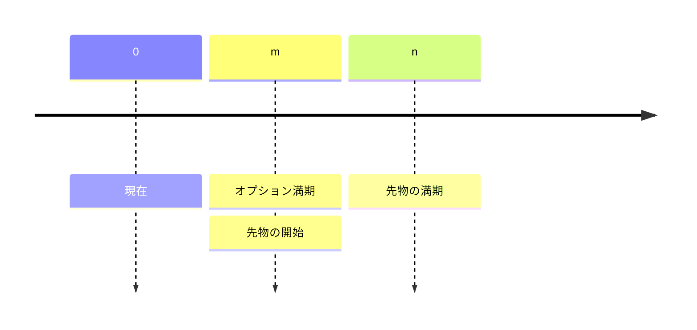
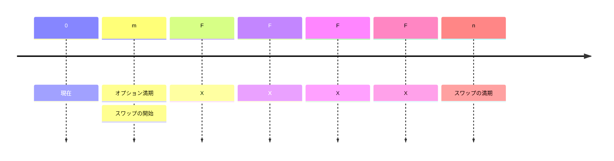

<style>
.blur-hover {
    filter: blur(5px);
    transition: filter 0.3s;
}
.blur-hover:hover {
    filter: none;
}
</style>

# オプション

基本となる考え方は**無裁定**である。

## 二項モデルによるオプション評価 {#binomial-option-valuation}

### 基本式 {#basic-formula}

リスク中立のもとで、二項ツリーの各ステップの式は次のとおり：
$$
\begin{align}

   S_u &= S_0 \cdot u\\
   S_d &= S_0 \cdot d\\
   p_u &= \frac{e^{r\Delta t}}{u-d}\\
   p_d &= 1-p_u\\
   C_T &= \max(S_T-X,0)\\
   C_0 &= e^{-r\Delta t} (pC_u + (1-p)C_d)

\end{align}
$$

```python
class BinomialTreeOption:
    def __init__(self, df_spy, X, T, r, N, option_type="call"):
        """
        Initialize the Binomial Tree for option pricing with stage-specific volatility.
        """
        self.df_spy = df_spy
        self.S = spy_price
        self.X = X
        self.T = T
        self.r = r
        self.N = N
        self.option_type = option_type
        self.dt = T / N  # Time step size

    def compute_rolling_volatility(self, current_date, window=30):
        """
        Compute rolling volatility up to a given trading date.
        """
        spy_subset = self.df_spy.loc[:current_date]  
        log_returns = np.log(spy_subset["Close"] / spy_subset["Close"].shift(1))
        rolling_vol = log_returns.rolling(window=window).std() * np.sqrt(252)

        return rolling_vol.iloc[-1]  
    def build_stock_tree(self):
        """
        Build the binomial tree for stock prices with dynamic volatility.
        """
        stock_tree = np.zeros((self.N + 1, self.N + 1))
        stock_tree[0, 0] = self.S  

        trading_dates = self.df_spy.index[-self.N:]  

        for i in range(1, self.N + 1):
            current_date = trading_dates[i - 1]  
            sigma_t = self.compute_rolling_volatility(current_date)  
            u = np.exp(sigma_t * np.sqrt(self.dt))  
            d = np.exp(-sigma_t * np.sqrt(self.dt))  

            for j in range(i + 1):
                stock_tree[j, i] = stock_tree[0, 0] * (u ** (i - j)) * (d ** j)

        return stock_tree

    def build_option_tree(self):
        """
        Build the option price tree using backward induction.
        """
        stock_tree = self.build_stock_tree()
        option_tree = np.zeros((self.N + 1, self.N + 1))

        if self.option_type == "call":
            option_tree[:, self.N] = np.maximum(stock_tree[:, self.N] - self.X, 0)
        elif self.option_type == "put":
            option_tree[:, self.N] = np.maximum(self.X - stock_tree[:, self.N], 0)

        trading_dates = self.df_spy.index[-self.N:] 

        for i in range(self.N - 1, -1, -1):
            current_date = trading_dates[i]  
            sigma_t = self.compute_rolling_volatility(current_date) 
            u = np.exp(sigma_t * np.sqrt(self.dt))
            d = np.exp(-sigma_t * np.sqrt(self.dt))
            p = (np.exp(self.r * self.dt) - d) / (u - d)  

            for j in range(i + 1):
                option_tree[j, i] = np.exp(-self.r * self.dt) * (
                    p * option_tree[j, i + 1] + (1 - p) * option_tree[j + 1, i + 1]
                )

        return option_tree

    def price(self):
        """
        Compute the option price at time 0.
        """
        option_tree = self.build_option_tree()
        return option_tree[0, 0]

def compute_binomial_price(row, df_spy, r, N):
    X = row["strike"]
    expiration = row["expiration"]
    # set to global T
    T_local = T
    option = BinomialTreeOption(df_spy, X, T_local, r, N)
    return option.price()
```

### 構成要素 {#components}

二項ツリーの基本的な仮定：

* $S_0$ から始まる
* 上昇 $U$、下落 $D$。デフォルトは $D=\frac{1}{U}$。

#### モデル 1 {#model-one}

Bruce Tuckman が債券の価格決定を表すために提案したもの：
$$
dr = \sigma dw
$$


ここで $r$ は金利、$w$ はランダムウォークの確率過程。時間が $1$ のとき、$r_u =r+\sigma$、$r_d = r-\sigma$。したがって $S_u = Se^{\sigma}=SU$、$S_d=Se{-\sigma}=SD$ となり、デフォルトで $D=\frac{1}{U}$。

### リスク中立確率 {#risk-neutrual-probability}

無裁定から、期待株価は：
$$
E(S_t) = \pi_uS_0U+(1-\pi_u)S_9D
$$
これは無リスクのリターン $S_0(1+r_f)^t$ に等しいはずなので：
$$
\begin{align}
\pi_u &= \frac{(1+r_f)^T-D}{U-D}\\
\pi_d &= 1-\pi_u = \frac{U-(1+r_f)^T}{U-D}
\end{align}
$$

### 1 期間二項モデル {#one-period-binomial-model}

ヨーロピアン・オプションを仮定する：
$$
\begin{align}
C_{u,t}&= \max(0, S_u-X)\\
P_{u,t}&=\max(0, X-S-u)\\
C_{d,t}&=\max(0,S_d-X)\\
P_{d,t}&=\max(0,X-S_d)
\end{align}
$$
すると $C_0=PV(E(C))=\frac{(\pi_u C_{u,t}+\pi_d C_{d,t})}{(1+r_f)^t}$、$P_o = \frac{(\pi_u P_{u,t}+\pi_d P_{d,t})}{(1+r_f)^t}$。

### プット・コール・パリティ {#put-call-parity}

|              | **フィデューシャリー・コール**      | **プロテクティブ・プット** |
| ------------ | ----------------------- | ------------------ |
|              | $c + \frac{X}{1+r_f}^t$ | $S+p$              |
| **S ≤ X のとき** | $0+X=X$                 | $S+(X-S)=X$        |
| **S ≥ X のとき** | $(S-X)+X=S$             | $S+0=S$            |

したがって：
$$
c+\frac{X}{(1+r_f)^t}=S_0+p
$$

### 無リスク・ポートフォリオ法 {#risk-free-portfolio-method}

1. 株式を $\delta$ 単位買い、コールを 1 単位売って無リスク・ポートフォリオを作る。時点 $0$ でのポートフォリオの価値は：
   $$
   V_{0}=c-\delta S_0
   $$

2. 時点 $t$ では：
   $$
   \begin{align}
   V_{u,t}&=\delta S_u-C_u\\
   V_{d,t}&=\delta S_d-C_d
   \end{align}
   $$

3. ポートフォリオは無リスクなので $V_{u,t}=V_{d,t}$。これを解くと：
   $$
   \delta S_0 = \frac{C_u-C_d}{U-D}
   $$

4. $V_{u,t}=V_{d,t}=(1+r_f)^t V_0$（$V_0 = c-\delta S_0$）から $C_0$ を解く：
   $$
   C_0 = \delta S_0+\delta S_u -C_u
   $$
   すると、リスク中立確率法と同じ式が得られる。


> [!Note]
>
> 価値が一致しないときは裁定機会があり、$\delta$ が裁定比率になる。


### 2 期間二項モデル {#two-period-binomial-model}

1 期間モデルと同じく、$\pi_u$ と $\pi_d$ は同じ方法で計算できる（実際、同じ値になる！）。あとは株価の期待値の現在価値を計算すればよい。

#### 例 {#example}

現在 €50 の無配当株を考える。この株を原資産とするヨーロピアン・コールは満期まで 2 年、行使価格は €50。無リスク金利は年 5% とする。さらに上昇係数（U）は 1.356、下落係数（D）は 0.744。これらの情報から、コール・オプションと対応するプット・オプションの現在価値を計算せよ。

<span class="blur-hover">

次の手順で解く。

**ステップ 1**：二項ツリーの株価を計算する。上・上の価格は $S^{++} = 91.94$、上・下と下・上の価格は $S^{+-} = S^{-+} = 50.44$、下・下の価格は $S^{–} = 27.68$。

**ステップ 2**：満期時のオプションの価値を計算する。コールは $C^{++} = 41.95$、$C^{+-} = C^{-+} = 0.44$、下・下のコールの価値は $C^{–} = 0$。プットは $P^{++} = P^{+-} = P^{-+} = 0$、$P^{–} = 22.32$。

**ステップ 3**：リスク中立確率を計算する。上昇確率は $\pi_U = \frac{(1 + 0.05) - 0.744}{1.356 - 0.744} = 0.5$、下落確率は $\pi_D = 1 - \pi_U = 0.5$。

続いて中間ノードのオプション価値を計算する。コールは $C^{+} = \frac{(0.5 \times 41.94 + 0.5 \times 0.44)}{1.05} = 20.18$、$C^{-} = \frac{(0.5 \times 0.44 + 0.5 \times 0)}{1.05} = 0.22$。プットは $P^{+} = \frac{(0.5 \times 0 + 0.5 \times 0)}{1.05} = 0$、$P^{-} = \frac{(0.5 \times 0 + 0.5 \times 22.32)}{1.05} = 10.63$。

**ステップ 4**：当初の価値を計算する。コールの価値は $C_0 = \frac{(0.5 \times 20.18 + 0.5 \times 0.22)}{1.05} = 9.71$、プットの価値は $P_0 = \frac{(0.5 \times 0 + 0.5 \times 10.63)}{1.05} = 5.06$。

補足として、プット・コール・パリティの式で確かめられる：

$P_0 = C_0 + PV(X) - S_0 = 9.71 + \frac{50}{(1.05)^2} - 50 = 5.06$。

</span>

### アメリカン・オプションの早期行使 {#advance-exercise-of-american-option}

* 無配当株のアメリカン・コールは早期行使されない。オプションの価値が行使価値を上回るからである：*死ぬより生きているほうが価値がある*。
* 配当のある株のアメリカン・コールや、ディープ・イン・ザ・マネーのオプションは早期行使されうる。

### アメリカン・オプションの 2 期間二項モデル {#two-period-binomial-model-of-american-option}

アメリカン・オプションは次のとき早期行使されうる：

* 行使価値が無裁定価値を上回る
* 各ノードで、行使価値と計算した価格のうち高いほうを使う。

> [!Note]
>
> 行使した場合のオプション価値を計算すること

### 金利オプション {#interest-rate-option}

評価の手順は標準的な二項モデルと同じだが、想定元本を掛ける。


## ブラック・ショールズ・モデル {#black-scholes-model}

### 仮定 {#assumption}

ブラック・ショールズ・モデルは二項モデルの連続版である（$t\to\infty$ のとき）。

* 原資産は幾何ブラウン運動に従い、価格はなめらかに（連続的に）動く。

* 連続複利の無リスク金利は一定で既知。無リスク金利で借入・貸付ができるとする。
* 原資産のボラティリティは一定
* 市場に摩擦がない：
  * 取引コスト、税金、規制上の制約がない
  * 裁定機会がない
  * 原資産は流動性が高く、連続的に取引できる
  * 原資産の空売りが認められている

### 基本式 {#basic-formula-1}

ブラック・ショールズの式は：
$$
\begin{align}

​    C_0 &= S_0 N(d_1) - X e^{-r_f^cT} N(d_2) \\
P_0&= C_0+Xe^{-r_f^cT}-S_0\\
&=-S_0N(-d_1)+Xe^{-r_f^cT}N(-d_2)
\\

​    d_1 &= \frac{\ln(\frac{S_0}{X}) + (r_f^c + \frac{1}{2} \sigma^2)T}{\sigma\sqrt{T}} \\

​    d_2 &= d_1 - \sigma\sqrt{T}

\end{align}
$$

```python
def black_scholes(S, X, T, r, sigma):
    d1 = (np.log(S / X) + (r + 0.5 * sigma ** 2))/(sigma * np.sqrt(T))
    d2= d1 - sigma * np.sqrt(T)
    return S * norm.cdf(d1) - X * np.exp(-r * T) * norm.cdf(d2)
```

### モデルの直観 {#initial-model}

プット・コール・パリティと同様に、**コール・オプション**はレバレッジをかけた株式投資（株式を $N(d_1)$ 買い、無リスクのゼロクーポン債を $N_(d_2)$ 空売り）とみなせる。**プット・オプション**は無リスク資産を $N(-d_2)$ 買い、株式を $N(-d_1)$ 空売りしたものとみなせる。

#### $N(d_1)$ と $N(d_2)$ についての結論 {#conclusion-of-n-d-1-and-n-d-2}

* $N(d_1)$ はコール・オプションの $\delta$
* $-N(-d_1)$ はプット・オプションの $\delta$
* $N(d_2)$ は、コール・オプションが満期に行使される（イン・ザ・マネーになる）リスク中立確率。
* $N(-d_2)$ は、プット・オプションが満期に行使される（イン・ザ・マネーになる）リスク中立確率。
* $N_(-d_2)=1-N(d_2)$。

### 保有便益・保有コストを考慮した BSM モデル {#bsm-model-with-carrying-benefits-or-costs}

$$
\begin{align}
C_o &= S_0e^{-\gamma T}N(d_1)-Xe^{-r_f^cT}N(d_2) \\
P_o &= -S_0e^{-\gamma T}N(-d_1)+Xe^{-r_f^c T}N(-d_2) \\
d_1 &=\frac{\ln(\frac{S_0}{X})+(r_f^c-\gamma+\frac{\sigma^2}{2})}{\sigma\sqrt{T}}\\
d_2 &= d_1-\sigma\sqrt{T}
\end{align}
$$

### 先物オプション {#options-on-future}



#### ポジション {#position}

先物のポジションは、オプションのポジションによって決まる：

* コールの買い $\to$ 先物のロング
* プットの買い $\to$ 先物のショート

行使価格はオプションで約定される。コールの買いは $F<F_m(n)$ なら行使、プットの買いは $F> F_m(n)$ なら行使する。

#### ブラック・モデル {#black-model}

$$
\begin{align}
C_0 &= F_0(T)e^{-r_f^cT}N(d_1)-Xe^{-r_f^cT}N(d_2)\\
P_0 &= -F_0(T)e^{-r_f^cT}N(-d_1)+Xe^{-r_f^cT}N(-d_2)\\
d_1 &= \frac{\ln (\frac{F_0(T)}{X})+\frac{\sigma^2}{2}T}{\sigma\sqrt{T}}\\
d_2&=d_1-\sigma\sqrt{T}
\end{align}
$$

> [!Important]
>
> 実務では、オプションと先物の満期は同じ時点に設定されることが多い（アメリカン・オプション）。

### 金利オプション {#interest-rate-option-1}

この契約は先物オプションや FRA に似ている。ポジションの判断と行使のケースは先物オプションとまったく同じである。
$$
\begin{align}
C_0 &= NPe^{-r_f^c n \frac{30}{360}}(FR_{m\times n} N(d_1)-XN(d_2))\frac{(n-m)30}{360}\\
P_0 &= NP e^{-r_f^cn\frac{30}{360}}(XN(-d_2)-FR_{m\times n}N(-d_1))\frac{(n-m)30}{360}
\end{align}
$$
### スワップション {#swapation}

スワップションは、スワップを結ぶ権利（オプション）である：

1. ペイヤーズ・スワップションは、固定金利の支払い側としてスワップを結ぶ権利（ロング）。
2. レシーバーズ・スワップションは、固定金利の受け取り側としてスワップを結ぶ権利（ショート）。

$$
\begin{align}
C_0 &= NP(\text{Accural Period})\text{PVA of}(R_{fix}N(d_1)-R_XN(d_2))\\
P_0 &= NP(\text{Accural Period})\text{PVA of}(-R_{fix}N(-d_1)+R_XN(-d_2))
\end{align}
$$



## グリークス {#greeks}

ブラック・ショールズ・モデルから、
$$
C_0 = S_0 N(d_1) - X e^{-r_f^cT} N(d_2) 
$$
これは次のように理解できる：
$$
C_0 = f(S_0, X, r_f^c, T, \sigma)
$$
すると $\delta$ は次のように定義される：
$$
\delta = \frac{\partial C_0}{\partial S_0}
$$
$\gamma$ は：
$$
\gamma = \frac{\partial^2 C_0}{\partial S_0^2}=\frac{\partial \delta}{\partial S_0}
$$
$\theta$ は：
$$
\theta = \frac{\partial C_0}{\partial t}
$$
$\upsilon$ は：
$$
\upsilon = \frac{\partial C_0}{\partial \sigma}
$$
$\rho$ は：
$$
\rho = \frac{\partial C_0}{\partial r_f^ c}
$$

### デルタ {#delta}

無配当株では：$\delta_{call}=N(d_1)$、$\delta_{put} = -N(-d_1)$。

> [!Note]
>
> この場合、$\delta_{call}=\delta_{put}+1$


配当のある株では：$\Delta_{call}=e^{-\delta T}N(d_1), \Delta_{put}=-e^{-\delta T}N(-d_1)$。ここでの $\delta$ は配当利回りを表す。

> [!Note]
>
> $\delta$ はコールでは $(0,1)$、プットでは $(-1, 0)$ の範囲にある。満期が近づくほど大きく変化する。

### ガンマ {#gamma}

> [!Note]
>
> $\gamma$ と $\delta$ は、債券でいうコンベクシティとデュレーションにあたる。

$\gamma$ はアット・ザ・マネーで最大になる。アット・ザ・マネーでは満期が近づくほど $\gamma$ は大きくなる。ディープ・イン・ザ・マネーやアウト・オブ・ザ・マネーのオプションでは、満期が近づくほど $\gamma$ は小さくなる。

> [!Note]
>
> オプションのポジションを組み合わせて **$\gamma$ ニュートラル戦略**を作り、さらに原資産の株式のポジションを加えて $\delta$ ニュートラル戦略にできる（株式には $\gamma$ がないため）。

### シータ {#theta}

コールもプットも時間の経過とともに価値が減るので、シータは通常マイナスである。ただし：

* **例外：** ディープ・イン・ザ・マネーのプット・オプション
