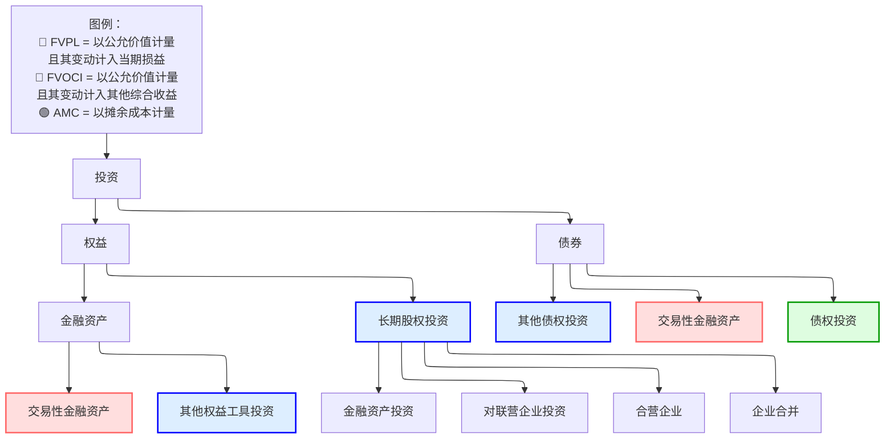

# 公司间投资

## 公司投资的基本类别

### 类别

下图从会计角度描述了投资的类别。

#### 长期股权投资

如上所述，根据控制力的大小，长期股权投资分为 4 类：

* **金融资产投资**：没有重大控制或影响
* **对联营企业投资**：施加重大影响
* **合营企业**：共同控制
* **企业合并**：取得控制权

通常用**持股比例**来确定适当的类别：

* $(0,20)$ 缺乏影响
* $(20,50)$ 重大影响
* $(50,100)$ 控制

|                            | 金融资产         | 联营企业            | 合营企业 | 企业合并 |
| -------------------------- | ------------------------ | --------------------- | -------------- | -------------------- |
| **影响程度**    | 无重大影响 | 重大影响 | 共同控制 | 控制              |
| **持股比例** | < 20%                    | 20% - 50%             | 不定         | > 50%                |
| **被投资方称谓**       | -                        | 联营企业             | -              | 子公司           |
| **会计处理**   | AMC、FVOCI、FVPL         | 权益法         | 权益法  | 购买法   |

> [!Note]
>
> 结合后面的内容回顾此表，了解具体方法。

> [!Important]
>
> 在收购情形下，注意公司之间是否存在共同控制方，即两个或多个实体受同一控制方控制。

## 金融资产投资

### 金融资产的分类

# 复习笔记

##  分类

债务工具

* 以收取合同现金流为目的持有 $\to$ AMC（摊余成本），固定价值（按发行利率折现现金流）
* 既以收取现金流又以出售为目的持有 $\to$ FVOCI，计入其他综合收益（公允价值）
* 交易性 $\to$ FVPL，计入利润表（公允价值）

权益工具

* 既以收取现金流又以出售为目的持有 $\to$ FVOCI，计入其他综合收益
* 交易性 $\to$ FVPL，计入利润表

>[!note]
>
>* 持有收益（利息收入）固定为摊余成本 $\times$ 发行利率，计入**利润表**
>
>* 利得/损失的处理不同：AMC 不确认，FVOCI 计入 OCI，FVPL 计入利润表

## 重分类

* IFRS 不允许权益工具重分类
* 当业务模式发生变化时，允许债务工具重分类

## 披露

所有情况下都要求披露公允价值

## 会计处理

### 权益法

> [!note]
>
> 联营/合营企业的定义：具有重大影响但不构成控制

#### 资产负债表处理

* 股权投资的账面价值按成本入账
* +调整后的净利润（报告净利润 - 公允价值摊销 - 未实现利润）
* -股利
* =期末股权投资账面价值

#### 利润表处理

* 收购方的净利润
* +被收购方调整后的净利润
* =合并净利润

#### 内含商誉

内含商誉 = 购买成本 $- \ \%\times$ FVNIA（可辨认净资产公允价值）

#### 公允价值摊销

FVA = $\frac{\text{FV(PPE)}-\text{BV(PPE)}}{N}$（直线折旧法）

#### 未实现利润（递延利润）

顺流交易：收购方 $\to$ 被收购方

逆流交易：被收购方 $\to$ 收购方

顺流和逆流交易都不应计入净利润，应在利润表中扣除。

#### 减值

|                     | IFRS                                  | US GAAP                       |
| ------------------- | ------------------------------------- | ----------------------------- |
| **减值测试** | 账面价值 > *可收回金额* | 账面价值 > *公允价值* |
| **减值损失** | 计入利润表                     | 计入利润表             |
| **转回**        | *允许*                              | *禁止*                    |

#### 权益法的分析问题

* 低估负债率
* 高估净利润率（NI/REV=(NIA+NIB)/REVA）

### 购买法

>[!note]
>
>子公司/VIE 的定义：投资方控制被投资方的经营活动
>
>类型：A+B = (A+B)，A+B = A
>
>VIE 或 SPE 是一种法律结构：公司希望在不拥有另一实体的情况下保持对其的控制

#### 资产负债表情形

* 部分收购且存在溢价：全部商誉 > 部分商誉，全部少数股东权益 > 部分少数股东权益
* 全额收购：全部商誉 = 部分商誉，全部少数股东权益 = 部分少数股东权益 = 0
* 折价收购：在利润表确认利得

#### 利润表合并

**收购后 A 的利润表：**

| 项目       | 金额 |
| ---------- | ----- |
| 收入     | X     |
| 费用    | Y     |
| 净利润 | Z     |

**收购后 B 的利润表（经公允价值调整后）：**

| 项目       | 金额 |
| ---------- | ----- |
| 收入     | x     |
| 费用    | y     |
| 净利润 | z     |

**收购后 A 的合并利润表：**

| 项目                             | 公式     |
| -------------------------------- | ----------- |
| 收入                           | X + x       |
| 费用                          | Y + y       |
| 净利润                       | Z + z       |
| 归属于母公司的净利润 | Z + % × z   |
| 少数股东权益                | (1 - %) × z |

**步骤：**
1. 对 B 的利润表做**公允价值调整**（公允价值摊销和递延利润）
2. **100% 合并**
3. **计算归属于母公司的净利润**

#### 商誉减值

|                     | IFRS                                             | US GAAP                                |
| ------------------- | ------------------------------------------------ | -------------------------------------- |
| **对象**          | 资产组                                            | 商誉                               |
| **减值测试** | 账面价值（资产组）> *可收回金额（资产组）*  | 账面价值（商誉）> *公允价值（商誉）* |
| **减值**      | 1. 商誉减至 0                      | 商誉减至 0，              |
|                     | 2. 其他资产按比例减值 | 其他资产不再进一步减值   |
| **转回**         | 不允许                                      | 不允许                            |

#### 与权益法的比较（假设持股比例 < 100%）

| 财务报表与比率 | 权益法      | 购买法           |
| -------------------------- | ------------------ | ---------------------------- |
| 资产与负债         | 较低：A / L       | 较高：(A + a) / (L + l) ↑  |
| 权益                     | 较低：E           | 较高：E + M ↑              |
| 收入与费用         | 较低：X / Y       | 较高：X + x / Y + y ↑      |
| 净利润 (NI)            | 相同：Z        | 相同：Z + 3%（假设）= |
| 净利润率          | 较高：NI / X     | 较低：NI / (X + x) ↓        |
| ROE 与 ROA                | 较高：NI / 平均 A | 较低：NI / 平均 (A + a) ↓    |
