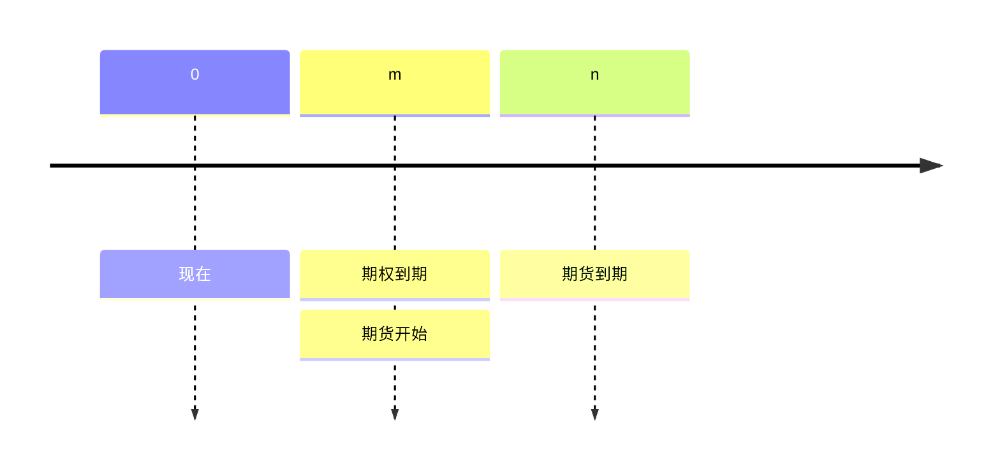
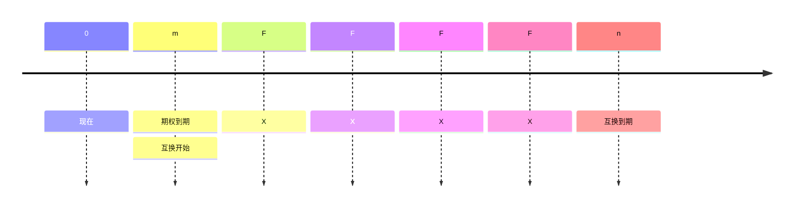

<style>
.blur-hover {
    filter: blur(5px);
    transition: filter 0.3s;
}
.blur-hover:hover {
    filter: none;
}
</style>

# 期权

基本逻辑是**无套利**。

## 二叉树期权估值

### 基本公式

在风险中性下，二叉树每一步的公式为：
$$
\begin{align}

   S_u &= S_0 \cdot u\\
   S_d &= S_0 \cdot d\\
   p_u &= \frac{e^{r\Delta t}}{u-d}\\
   p_d &= 1-p_u\\
   C_T &= \max(S_T-X,0)\\
   C_0 &= e^{-r\Delta t} (pC_u + (1-p)C_d)

\end{align}
$$

```python
class BinomialTreeOption:
    def __init__(self, df_spy, X, T, r, N, option_type="call"):
        """
        Initialize the Binomial Tree for option pricing with stage-specific volatility.
        """
        self.df_spy = df_spy
        self.S = spy_price
        self.X = X
        self.T = T
        self.r = r
        self.N = N
        self.option_type = option_type
        self.dt = T / N  # Time step size

    def compute_rolling_volatility(self, current_date, window=30):
        """
        Compute rolling volatility up to a given trading date.
        """
        spy_subset = self.df_spy.loc[:current_date]  
        log_returns = np.log(spy_subset["Close"] / spy_subset["Close"].shift(1))
        rolling_vol = log_returns.rolling(window=window).std() * np.sqrt(252)

        return rolling_vol.iloc[-1]  
    def build_stock_tree(self):
        """
        Build the binomial tree for stock prices with dynamic volatility.
        """
        stock_tree = np.zeros((self.N + 1, self.N + 1))
        stock_tree[0, 0] = self.S  

        trading_dates = self.df_spy.index[-self.N:]  

        for i in range(1, self.N + 1):
            current_date = trading_dates[i - 1]  
            sigma_t = self.compute_rolling_volatility(current_date)  
            u = np.exp(sigma_t * np.sqrt(self.dt))  
            d = np.exp(-sigma_t * np.sqrt(self.dt))  

            for j in range(i + 1):
                stock_tree[j, i] = stock_tree[0, 0] * (u ** (i - j)) * (d ** j)

        return stock_tree

    def build_option_tree(self):
        """
        Build the option price tree using backward induction.
        """
        stock_tree = self.build_stock_tree()
        option_tree = np.zeros((self.N + 1, self.N + 1))

        if self.option_type == "call":
            option_tree[:, self.N] = np.maximum(stock_tree[:, self.N] - self.X, 0)
        elif self.option_type == "put":
            option_tree[:, self.N] = np.maximum(self.X - stock_tree[:, self.N], 0)

        trading_dates = self.df_spy.index[-self.N:] 

        for i in range(self.N - 1, -1, -1):
            current_date = trading_dates[i]  
            sigma_t = self.compute_rolling_volatility(current_date) 
            u = np.exp(sigma_t * np.sqrt(self.dt))
            d = np.exp(-sigma_t * np.sqrt(self.dt))
            p = (np.exp(self.r * self.dt) - d) / (u - d)  

            for j in range(i + 1):
                option_tree[j, i] = np.exp(-self.r * self.dt) * (
                    p * option_tree[j, i + 1] + (1 - p) * option_tree[j + 1, i + 1]
                )

        return option_tree

    def price(self):
        """
        Compute the option price at time 0.
        """
        option_tree = self.build_option_tree()
        return option_tree[0, 0]

def compute_binomial_price(row, df_spy, r, N):
    X = row["strike"]
    expiration = row["expiration"]
    # set to global T
    T_local = T
    option = BinomialTreeOption(df_spy, X, T_local, r, N)
    return option.price()
```

### 组成部分

二叉树的基本假设：

* 从 $S_0$ 开始
* 上涨因子 $U$、下跌因子 $D$，默认 $D=\frac{1}{U}$。

#### 模型一

由 Bruce Tuckman 提出，用于描述固定收益定价：
$$
dr = \sigma dw
$$


其中 $r$ 是利率，$w$ 是随机游走过程。当时间为 $1$ 时，$r_u =r+\sigma$，$r_d = r-\sigma$。因此 $S_u = Se^{\sigma}=SU$，$S_d=Se{-\sigma}=SD$，所以默认 $D=\frac{1}{U}$。

### 风险中性概率

由无套利推出，预期股价为：
$$
E(S_t) = \pi_uS_0U+(1-\pi_u)S_9D
$$
它应等于无风险收益 $S_0(1+r_f)^t$，于是：
$$
\begin{align}
\pi_u &= \frac{(1+r_f)^T-D}{U-D}\\
\pi_d &= 1-\pi_u = \frac{U-(1+r_f)^T}{U-D}
\end{align}
$$

### 单期二叉树模型

现在假设是欧式期权：
$$
\begin{align}
C_{u,t}&= \max(0, S_u-X)\\
P_{u,t}&=\max(0, X-S-u)\\
C_{d,t}&=\max(0,S_d-X)\\
P_{d,t}&=\max(0,X-S_d)
\end{align}
$$
于是 $C_0=PV(E(C))=\frac{(\pi_u C_{u,t}+\pi_d C_{d,t})}{(1+r_f)^t}$，$P_o = \frac{(\pi_u P_{u,t}+\pi_d P_{d,t})}{(1+r_f)^t}$。

### 看跌–看涨平价

|              | **信托看涨**      | **保护性看跌** |
| ------------ | ----------------------- | ------------------ |
|              | $c + \frac{X}{1+r_f}^t$ | $S+p$              |
| **若 S ≤ X** | $0+X=X$                 | $S+(X-S)=X$        |
| **若 S ≥ X** | $(S-X)+X=S$             | $S+0=S$            |

于是有：
$$
c+\frac{X}{(1+r_f)^t}=S_0+p
$$

### 无风险组合法

1. 买入 $\delta$ 份股票并卖出一份看涨期权，构建无风险组合，组合在时刻 $0$ 的价值为：
   $$
   V_{0}=c-\delta S_0
   $$

2. 在时刻 $t$：
   $$
   \begin{align}
   V_{u,t}&=\delta S_u-C_u\\
   V_{d,t}&=\delta S_d-C_d
   \end{align}
   $$

3. 由于组合无风险，$V_{u,t}=V_{d,t}$，解得：
   $$
   \delta S_0 = \frac{C_u-C_d}{U-D}
   $$

4. 再由 $V_{u,t}=V_{d,t}=(1+r_f)^t V_0$（其中 $V_0 = c-\delta S_0$）解出 $C_0$：
   $$
   C_0 = \delta S_0+\delta S_u -C_u
   $$
   由此得到与风险中性概率法相同的公式。


> [!Note]
>
> 当价值不相等时存在套利机会，$\delta$ 即套利比率。


### 两期二叉树模型

与单期模型相同，$\pi_u$ 和 $\pi_d$ 可以用同样的方法计算（其实数值都一样！），然后计算股票期望的现值即可。

#### 示例

考虑一只不支付股利的股票，现价 €50。以该股票为标的的欧式看涨期权还有两年到期，行权价为 €50。假设无风险利率为每年 5%。此外，上涨因子（U）为 1.356，下跌因子（D）为 0.744。根据这些信息，计算该看涨期权以及相应看跌期权的当前价值。

<span class="blur-hover">

解题从以下步骤开始：

**第 1 步**：计算二叉树中的股价。上–上价格为 $S^{++} = 91.94$，上–下和下–上价格为 $S^{+-} = S^{-+} = 50.44$，下–下价格为 $S^{–} = 27.68$。

**第 2 步**：计算到期时的期权价值。对看涨期权，$C^{++} = 41.95$，$C^{+-} = C^{-+} = 0.44$，下–下看涨价值为 $C^{–} = 0$。对看跌期权，$P^{++} = P^{+-} = P^{-+} = 0$，$P^{–} = 22.32$。

**第 3 步**：计算风险中性概率。上涨概率为 $\pi_U = \frac{(1 + 0.05) - 0.744}{1.356 - 0.744} = 0.5$，下跌概率为 $\pi_D = 1 - \pi_U = 0.5$。

接着计算中间节点的期权价值。看涨：$C^{+} = \frac{(0.5 \times 41.94 + 0.5 \times 0.44)}{1.05} = 20.18$，$C^{-} = \frac{(0.5 \times 0.44 + 0.5 \times 0)}{1.05} = 0.22$。看跌：$P^{+} = \frac{(0.5 \times 0 + 0.5 \times 0)}{1.05} = 0$，$P^{-} = \frac{(0.5 \times 0 + 0.5 \times 22.32)}{1.05} = 10.63$。

**第 4 步**：计算初始价值。看涨期权价值为 $C_0 = \frac{(0.5 \times 20.18 + 0.5 \times 0.22)}{1.05} = 9.71$，看跌期权价值为 $P_0 = \frac{(0.5 \times 0 + 0.5 \times 10.63)}{1.05} = 5.06$。

另外提示一下，可以用看跌–看涨平价公式验证：

$P_0 = C_0 + PV(X) - S_0 = 9.71 + \frac{50}{(1.05)^2} - 50 = 5.06$。

</span>

### 美式期权的提前行权

* 以不支付股利的股票为标的的美式看涨期权不会提前行权，因为期权价值大于行权价值：*活着比死了更值钱*。
* 以支付股利的股票为标的、或深度实值的美式看涨期权可能提前行权。

### 美式期权的两期二叉树模型

美式期权在以下情况下可能提前行权：

* 行权价值大于无套利价值
* 在每个节点取行权价值与计算价格中较高者。

> [!Note]
>
> 计算行权时的期权价值

### 利率期权

估值过程与标准二叉树模型相同，只是要乘以名义本金。


## Black-Scholes 模型

### 假设

Black-Scholes 模型是二叉树模型的连续形式（当 $t\to\infty$ 时）。

* 标的资产服从几何布朗运动，价格平滑（连续）变动。

* 连续复利无风险利率恒定且已知，假设可以按无风险利率借贷。
* 标的资产的波动率恒定
* 市场无摩擦：
  * 没有交易成本、税收和监管限制
  * 无套利
  * 标的资产流动性很高，可以连续交易
  * 允许卖空标的资产

### 基本公式

Black-Scholes 公式为：
$$
\begin{align}

​    C_0 &= S_0 N(d_1) - X e^{-r_f^cT} N(d_2) \\
P_0&= C_0+Xe^{-r_f^cT}-S_0\\
&=-S_0N(-d_1)+Xe^{-r_f^cT}N(-d_2)
\\

​    d_1 &= \frac{\ln(\frac{S_0}{X}) + (r_f^c + \frac{1}{2} \sigma^2)T}{\sigma\sqrt{T}} \\

​    d_2 &= d_1 - \sigma\sqrt{T}

\end{align}
$$

```python
def black_scholes(S, X, T, r, sigma):
    d1 = (np.log(S / X) + (r + 0.5 * sigma ** 2))/(sigma * np.sqrt(T))
    d2= d1 - sigma * np.sqrt(T)
    return S * norm.cdf(d1) - X * np.exp(-r * T) * norm.cdf(d2)
```

### 模型的直观理解

与看跌–看涨平价类似，**看涨期权**可以看作加杠杆的股票投资（买入股票 $N(d_1)$ 并卖空无风险零息债券 $N_(d_2)$）。**看跌期权**可以看作买入无风险资产 $N(-d_2)$ 并卖空股票 $N(-d_1)$。

#### 关于 $N(d_1)$ 和 $N(d_2)$ 的结论

* $N(d_1)$ 是看涨期权的 $\delta$
* $-N(-d_1)$ 是看跌期权的 $\delta$
* $N(d_2)$ 是看涨期权到期时被行权（实值）的风险中性概率。
* $N(-d_2)$ 是看跌期权到期时被行权（实值）的风险中性概率。
* $N_(-d_2)=1-N(d_2)$。

### 含持有收益或成本的 BSM 模型

$$
\begin{align}
C_o &= S_0e^{-\gamma T}N(d_1)-Xe^{-r_f^cT}N(d_2) \\
P_o &= -S_0e^{-\gamma T}N(-d_1)+Xe^{-r_f^c T}N(-d_2) \\
d_1 &=\frac{\ln(\frac{S_0}{X})+(r_f^c-\gamma+\frac{\sigma^2}{2})}{\sigma\sqrt{T}}\\
d_2 &= d_1-\sigma\sqrt{T}
\end{align}
$$

### 期货期权



#### 头寸

期货的头寸取决于期权的头寸：

* 买入看涨 $\to$ 期货多头
* 买入看跌 $\to$ 期货空头

行权价在期权中约定。对于买入看涨，若 $F<F_m(n)$ 则行权；对于买入看跌，若 $F> F_m(n)$ 则行权。

#### Black 模型

$$
\begin{align}
C_0 &= F_0(T)e^{-r_f^cT}N(d_1)-Xe^{-r_f^cT}N(d_2)\\
P_0 &= -F_0(T)e^{-r_f^cT}N(-d_1)+Xe^{-r_f^cT}N(-d_2)\\
d_1 &= \frac{\ln (\frac{F_0(T)}{X})+\frac{\sigma^2}{2}T}{\sigma\sqrt{T}}\\
d_2&=d_1-\sigma\sqrt{T}
\end{align}
$$

> [!Important]
>
> 实践中，期权和期货通常设定在同一时间到期（美式期权）。

### 利率期权

该合约类似于期货期权和 FRA。头寸判断和行权情形与期货期权完全相同。
$$
\begin{align}
C_0 &= NPe^{-r_f^c n \frac{30}{360}}(FR_{m\times n} N(d_1)-XN(d_2))\frac{(n-m)30}{360}\\
P_0 &= NP e^{-r_f^cn\frac{30}{360}}(XN(-d_2)-FR_{m\times n}N(-d_1))\frac{(n-m)30}{360}
\end{align}
$$
### 互换期权

互换期权是进入互换的期权：

1. 支付方互换期权是以固定利率支付方身份进入互换的期权（多头）。
2. 收取方互换期权是以固定利率收取方身份进入互换的期权（空头）。

$$
\begin{align}
C_0 &= NP(\text{Accural Period})\text{PVA of}(R_{fix}N(d_1)-R_XN(d_2))\\
P_0 &= NP(\text{Accural Period})\text{PVA of}(-R_{fix}N(-d_1)+R_XN(-d_2))
\end{align}
$$



## 希腊字母

由 Black-Scholes 模型，
$$
C_0 = S_0 N(d_1) - X e^{-r_f^cT} N(d_2) 
$$
可以把它理解为：
$$
C_0 = f(S_0, X, r_f^c, T, \sigma)
$$
于是 $\delta$ 定义为：
$$
\delta = \frac{\partial C_0}{\partial S_0}
$$
$\gamma$ 定义为：
$$
\gamma = \frac{\partial^2 C_0}{\partial S_0^2}=\frac{\partial \delta}{\partial S_0}
$$
$\theta$ 定义为：
$$
\theta = \frac{\partial C_0}{\partial t}
$$
$\upsilon$ 定义为：
$$
\upsilon = \frac{\partial C_0}{\partial \sigma}
$$
$\rho$ 定义为：
$$
\rho = \frac{\partial C_0}{\partial r_f^ c}
$$

### Delta

对于不支付股利的股票：$\delta_{call}=N(d_1)$，$\delta_{put} = -N(-d_1)$。

> [!Note]
>
> 这种情况下，$\delta_{call}=\delta_{put}+1$


对于支付股利的股票：$\Delta_{call}=e^{-\delta T}N(d_1), \Delta_{put}=-e^{-\delta T}N(-d_1)$，这里的 $\delta$ 表示股息率。

> [!Note]
>
> 看涨期权的 $\delta$ 介于 $(0,1)$，看跌期权介于 $(-1, 0)$。越接近到期日，它的变化越剧烈。

### Gamma

> [!Note]
>
> $\gamma$ 和 $\delta$ 就相当于固定收益中的凸性和久期。

$\gamma$ 在平值时达到最大。对于平值期权，越接近到期日 $\gamma$ 越大；对于深度实值和深度虚值期权，越接近到期日 $\gamma$ 越小。

> [!Note]
>
> 可以通过组合期权头寸构建 **$\gamma$ 中性策略**，再加入标的股票头寸进一步构建 $\delta$ 中性策略（因为股票没有 $\gamma$）。

### Theta

看涨和看跌期权的 Theta 通常都为负，因为它们的价值会随时间流逝而下降。其中：

* **例外：** 深度实值的看跌期权
